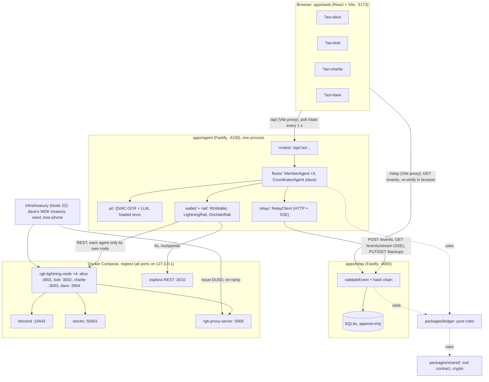

# Architecture

This page maps the kit+ty monorepo for developers: what each app and package owns, how they talk
to each other, how data flows from the browser to the Lightning nodes, and which exact versions
of the stack are used. Read it before changing code, or to check that a claim elsewhere in these
docs matches the structure of the repo.

## Components

**One process, separate wallets.** The four agents run in one Node process so the AI models are
loaded once, but each `MemberAgent` is constructed with only its own member's `Wallet`
(`apps/agent/src/index.ts`, `flows/runtime.ts`). In production the agent and the node would run
on each traveler's phone.

## Monorepo map

| Path | Package | Owns |
| --- | --- | --- |
| `packages/shared` | `@kitty/shared` | The contract between everything: zod schemas for ids, money (bigint on the TypeScript side, decimal strings on the wire), domain types, the 17 event types, views, the agent HTTP routes, a typed agent client, canonical JSON (RFC 8785) and sha256, ed25519 verification and the bind-invoice check (`crypto.ts`). Bundled into the web app too, so no Node-only modules. |
| `packages/ledger` | `@kitty/ledger` | Pure money logic and rules, no I/O: exact FX with rational rates, receipt split and rounding, `deriveTrip`, `validateEvent`, `decideAutoPay`, `liquidityPlan`. |
| `packages/rln-client` | `@kitty/rln-client` | Typed client for the rgb-lightning-node REST API, generated from `docs/vendor/rln-openapi.yaml` with `openapi-typescript` (`pnpm rln:gen`), on `openapi-fetch`. |
| `apps/relay` | `@kitty/relay` | The relay: SQLite append-only log, validation with the ledger, hash chain, SSE, backup blobs, a BOLT11 decoder that verifies the invoice signature. |
| `apps/agent` | `@kitty/agent` | The agents: `ai/` (QVAC), `flows/` (member and coordinator logic, local verified copy of the log), `wallet/` (RLN wallet), `rail/` (Lightning and on-chain rails), `relay/` (relay client), `routes/` (HTTP API for the UI), `dev-fakes/` (fakes, `KITTY_FAKES=1` only), `e2e/` (end-to-end suites). |
| `apps/web` | `@kitty/web` | The phone-sized UI: traveler screens (Home, Groups, New expense, Profile, QR), dave's screens (Home, Members, Dispute, Cover), and shared Log and Proof screens. |
| `infra/` | | `docker-compose.yml`, the RLN Dockerfile and build script, shell scripts behind `infra:*`, `demo:*` and `e2e:*`, `fixtures/` (rates, receipt images and expected values). |
| `infra/treasury` | separate npm project | Scripts that need `@utexo/wdk-wallet-rgb` on Node 22: the seed, `unlock`, `lose-phone`, the no-fakes guard. It has its own lockfile and sits outside the pnpm workspace. |
| `spikes/` | | Time-boxed experiments, never imported by the apps. |

## Data flow

**Reads.** Each screen renders only from `GET /api/:as/state` (a `TripView`), polled every second
(`apps/web/src/config.ts`). The agent builds it from its own verified copy of the log
(`flows/local-log.ts`) plus live data from its own node (balances).

**Writes.** A user action is an HTTP call to the agent (for example
`POST /api/bob/expenses/:id/decision`). The agent checks the role from the path, builds the
event body, signs `canonical(inner)` with its ed25519 key, and appends the signed event to the
relay.

**The log.** The relay parses the event, derives the trip from every previous event, runs
`validateEvent`, assigns `seq`, `prevHash` and `hash`, stores it and pushes it to every
subscriber over SSE. Every agent runs `validateEvent` again on everything it receives; the first
event it rejects freezes its copy (`chainValid: false`) and the UI shows the red "relay sent an
entry this phone rejects" banner.

**Background loop.** Each `MemberAgent` reacts to events and to time: publishes `LINE_SEEN`,
evaluates `decideAutoPay`, pays (one payment at a time per wallet), publishes `PAYMENT_MADE`,
reissues expired invoices, publishes a `CHECKPOINT` every 10 events and backs up its node.
dave's `CoordinatorAgent` also runs `liquidityPlan`.

**Independent check.** The Log screen fetches `GET /events` from the relay through the `/relay`
Vite proxy and recomputes, in the browser, the schema, the chain and every ed25519 signature
(`apps/web/src/verify.ts`), trusting neither the relay nor its own agent.

## Wallet engines

Two engines were evaluated (`docs/spike-lightning.md`, `docs/spike-wdk.md`). The demo uses a
mixed setup:

| Role | Engine | Why |
| --- | --- | --- |
| Every member's Lightning node | `rgb-lightning-node` at commit `d4762ac`, in Docker, over REST (`rln-rest`) | Verified end to end: RGB channels, routed payments, preimages, cooperative close with sweep, backup and restore |
| dave's on-chain treasury: `DUSD` issuance and on-ramp | Tether WDK `@utexo/wdk-wallet-rgb` `2.0.3` (rgb-lib `0.3.0-beta.8`) on Node 22 | WDK's RGB wallet module; its native binary does not build on Node 24 |
| In-process Lightning node (`@utexo/wdk-rgb-lightning`) | not used | In `0.1.0-beta.15` the signer state did not survive a restart, cooperative closes did not sweep the asset back on-chain, and VSS restore hung. On the roadmap. |

The `Wallet` interface (`apps/agent/src/wallet/types.ts`) hides the engine from the flows,
ledger, relay and UI.

## Stack and versions

Exact versions from `pnpm-lock.yaml`, `infra/treasury/package.json`, `infra/docker-compose.yml`
and `infra/scripts/build-rln.sh`.

| Layer | Component | Version |
| --- | --- | --- |
| Bitcoin | Bitcoin Core (`registry.gitlab.com/hashbeam/docker/bitcoind`) | `30.2`, regtest |
| | electrs | `0.11.0` |
| | Esplora REST (`blockstream/esplora`) | pinned by digest `sha256:ef0921…f4541` |
| RGB | `rgb-proxy-server` | `0.3.0` |
| | `rgb-lightning-node` | commit `d4762ac3d1b3ca83f2f7b4f894e8569109dc572a` (image `settleup/rln:d4762ac`) |
| | `@utexo/wdk-wallet-rgb` / `@utexo/rgb-lib` | `2.0.3` / `0.3.0-beta.8` |
| | Asset | `DUSD`, NIA schema, precision 2 (RGB Protocol v0.11.1) |
| AI | `@qvac/sdk` | `0.21.0` (range `~0.21.0`); models `OCR_LATIN`, `OCR_CRAFT`, `QWEN3_1_7B_INST_Q4` |
| Runtime | Node.js | `22.23.3` (`.node-version`) |
| | pnpm | `12.11.2` |
| | TypeScript | `5.9.3` |
| | tsx | `4.23.15` |
| Backend | Fastify | `5.12.7` |
| | zod | `4.6.7` |
| | `@noble/curves` | `2.4.0` (ed25519, secp256k1) |
| | SQLite | `node:sqlite` built into Node 22 |
| | `openapi-fetch` / `openapi-typescript` | `0.17.0` / `7.13.0` |
| Frontend | React | `19.3.1` |
| | Vite | `8.3.4` |
| | Tailwind CSS | `4.3.3` |
| | `lucide-react` | `1.58.0` |
| Tooling | Vitest | `5.0.5` |
| | fast-check | `4.10.2` |
| | ESLint | `10.12.0` |
| | Prettier | `3.9.10` |

## Ports

| Port | Service |
| --- | --- |
| 5173 | web (Vite dev server; proxies `/api` → 4100 and `/relay` → 4000) |
| 4100 | agent API |
| 4000 | relay |
| 4400, 4500 | relay and agent started by the e2e suites (`E2E_RELAY_PORT`, `E2E_AGENT_PORT`) |
| 3001-3004 | RLN REST APIs of alice, bob, charlie, dave |
| 9735-9738 | RLN Lightning peer ports |
| 3000 | RGB proxy (JSON-RPC) |
| 3010 | Esplora REST |
| 18443 | bitcoind RPC |
| 50001 | electrs |

All of these listen on `127.0.0.1` only; `pnpm infra:check` verifies it for the Docker services.
