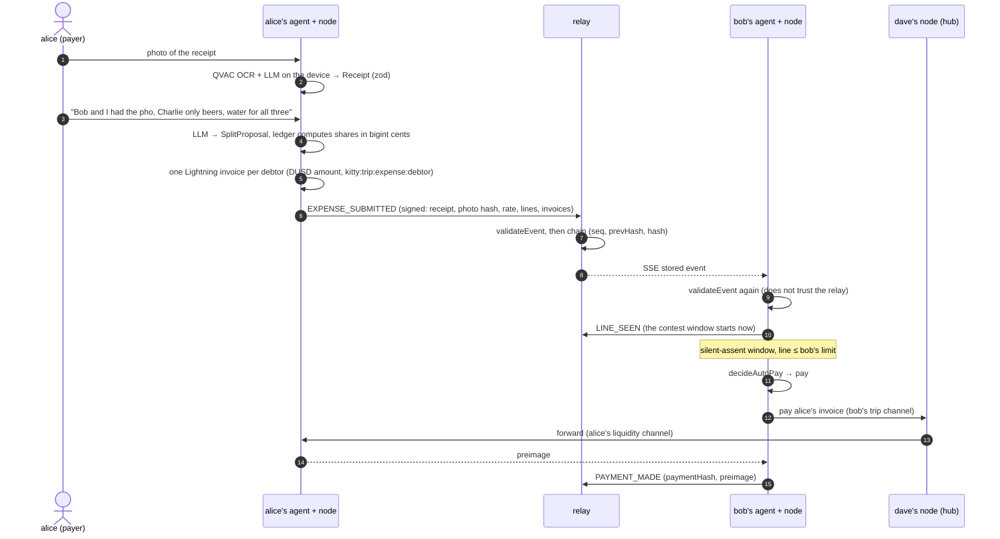
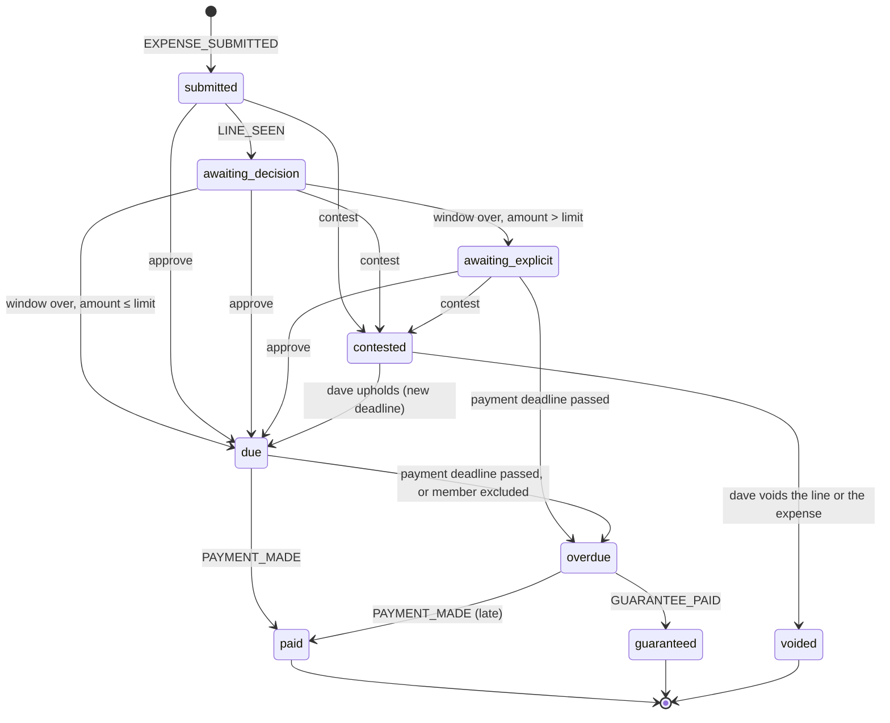

# How it works

This page explains kit+ty's product logic for a developer reader: who the actors are, what
happens to an expense from the photo to the payment, how a line moves through its states, how
the agent decides to pay, and what the operator guarantee and exclusion do. The rules described
here live in pure functions of `packages/ledger` (`deriveTrip`, `validateEvent`, `decideAutoPay`,
`liquidityPlan`), which the relay and the agents call rather than reimplement.

## Actors

| Actor            | Who                                                   | Can                                                                                                                                            | Cannot                                                                                        |
| ---------------- | ----------------------------------------------------- | ---------------------------------------------------------------------------------------------------------------------------------------------- | --------------------------------------------------------------------------------------------- |
| Traveler         | `alice`, `bob`, `charlie`                             | Submit expenses they paid; approve or contest **their own** lines; set their agent's limits                                                    | Approve someone else's line; spend someone else's funds                                       |
| Traveler's agent | one per traveler, holding only that traveler's wallet | Verify every event; mark lines as seen; pay due lines within the policy; publish checkpoints and backups                                       | Pay above the limits; pay contested or unverified lines                                       |
| Coordinator      | `dave`, employee of the tour operator                 | Create the trip; publish the rate of the day; admit members; resolve disputes; cover a default with the operator's liquidity; exclude a member | Move a traveler's funds; sign for them; approve lines for them                                |
| Relay            | a server that stores the log                          | Validate, order, chain and deliver signed events; keep backup blobs                                                                            | Create or modify events (they are signed); it can only refuse to deliver, which is detectable |

Each traveler has two channels with dave (`ln-2ch` mode):

- the **trip channel**, opened by the traveler with D = 50.00 `DUSD` of their own: their budget
  for the trip, spendable only by them;
- the **liquidity channel**, opened by dave with L = 30.00 `DUSD` of the operator's: it gives the
  traveler room to **receive** reimbursements.

RLN's `/openchannel` takes funds only from the side that opens it, so two single-funded channels
give the same result as a dual-funded one without anybody trusting anybody.

## The expense lifecycle

Step by step (code in `apps/agent/src/flows/`):

1. **Read the receipt.** `POST /api/:as/expenses/extract` runs OCR and the LLM on the device and
   returns a `Receipt` validated by zod. The payer reviews and corrects the rows in the UI. The
   photo never leaves the device: only its sha256 goes into the event. See
   [ai-pipeline.md](ai-pipeline.md).
2. **Split.** `POST /api/:as/expenses/split` turns the sentence into item assignments (an
   `AiResult<SplitProposal>`) and returns a **preview of the shares computed by the ledger**
   with today's rate.
3. **Submit.** `POST /api/:as/expenses` recomputes the shares, creates one invoice per debtor on
   the payer's node, signs `EXPENSE_SUBMITTED` and appends it to the relay. The rate of the day
   is locked into the event (`rateEventHash`, `rate`).
4. **Seen.** Each debtor's agent verifies the event and publishes `LINE_SEEN`. The windows start
   here, not at submission, so an expense posted at night does not expire while the debtor
   sleeps.
5. **Decide.** During the silent-assent window the debtor can approve or contest
   (`POST /api/:as/expenses/:id/decision`, which publishes `LINE_DECIDED`). If they do nothing and
   the line is within their limit, it becomes due by silent assent. Above the limit, it waits for
   an explicit approval.
6. **Pay.** A due line is paid by the debtor's agent over Lightning through dave. The agent
   publishes `PAYMENT_MADE` with the preimage; anyone can check `sha256(preimage) == paymentHash`
   of the invoice signed by the payer's node.

## Line states

A line is one (expense, debtor) pair. Its state is never stored: `deriveTrip(events, now)`
recomputes it from the log (`packages/ledger/src/kitty.ts`). The payer has no line for their own
share.

Timing rules, all counted from `LINE_SEEN`:

- the silent-assent window ends at `seenAt + silentAssentSeconds`;
- the payment deadline is `seenAt + paymentDeadlineSeconds`; after a dispute is upheld it is
  reset to `resolution time + paymentDeadlineSeconds`;
- `MEMBER_EXCLUDED` makes every open line of that member overdue at once;
- `EXPENSE_VOIDED` (by the payer, only if no line is paid or guaranteed) voids every open line.

| Parameter (`TripParams`) | Tests and `e2e:demo` (`DEMO_TRIP_PARAMS`) | Live demo (`pnpm dev` defaults) | Production (indicative)         |
| ------------------------ | ----------------------------------------- | ------------------------------- | ------------------------------- |
| `silentAssentSeconds`    | 20                                        | 45                              | hours                           |
| `paymentDeadlineSeconds` | 30                                        | 120                             | about a day                     |
| `invoiceExpirySeconds`   | 3600                                      | 3600                            | days                            |
| `tripChannelCents` (D)   | 5000 (50.00)                              | 5000                            | chosen by the traveler          |
| `liquidityCents` (L)     | 3000 (30.00)                              | 3000                            | from history, then just in time |
| `guaranteeCapCents` (G)  | 5000 (50.00)                              | 5000                            | chosen by the operator          |
| `channelCapacitySat`     | 1,000,000                                 | 1,000,000                       | sized by the operator           |

## The agent's policy

Each traveler sets their agent's limits (`PUT /api/:as/policy`, published as `POLICY_UPDATED`).
Defaults (`DEFAULT_POLICY` in `packages/shared/src/domain.ts`):

| Field               | Default      | Meaning                                                               |
| ------------------- | ------------ | --------------------------------------------------------------------- |
| `autoPayLimitCents` | 2000 (20.00) | Above this per line, no silent assent                                 |
| `dailyCapCents`     | 6000 (60.00) | Most the agent pays automatically in a rolling 24 h                   |
| `payUpheldDisputes` | `false`      | Whether the agent pays on its own a line it contested and dave upheld |

In the UI the limit is one slider from 0 ("Always ask me") to D ("Automatic payment"); the daily
cap is shown read-only.

`decideAutoPay(policy, line, trip, now, invoice)` (`packages/ledger/src/autopay.ts`) pays only if
**all** of these hold: the line is `due`; the trip is not closed; neither side is excluded; the
expense is verified and its totals add up; the invoice decoded by the debtor's own node is the
one signed in the log, payable to the creditor's registered node, for the trip asset and the
exact line amount, and not expired; and, for an automatic payment, the line is still within
`autoPayLimitCents` (checked again in case the policy changed) and within `dailyCapCents`. An
explicit approval pays regardless of the two limits. An overdue line is never paid
automatically.

Every outcome comes with the sentence the user reads, for example:

- "Will pay 3.09 to alice in 12 s unless you object."
- "Paid 3.09 to alice automatically: no objection in 20 s, under your limit of 20.00."
- "Needs your approval: 45.00 is above your automatic limit of 20.00."
- "Not paid: the invoice is not payable to alice's node."

## Disputes

A debtor contests with a reason during the window, or later while the line is still awaiting
an explicit approval. dave sees the reason, the receipt items assigned to that debtor by the AI
and the photo hash; the payer shows the photo in person. dave resolves with
`POST /api/dave/disputes/:expenseId/:member` (`DISPUTE_RESOLVED`):

- `upheld`: the line is due again with a new deadline. It is **not** paid automatically unless
  the debtor enabled `payUpheldDisputes`; otherwise the debtor approves it;
- `line_voided`: only that debtor's line is voided;
- `expense_voided`: the whole expense is voided.

## Operator guarantee and exclusion

An overdue line appears among dave's defaults. One button, "Cover and exclude"
(`POST /api/dave/defaults/:expenseId/:member/cover-and-exclude`, `apps/agent/src/flows/dave.ts`):

1. **Cover.** If the line fits in the guarantee left for that member (G minus what was already
   covered), dave's node pays **the same invoice** the debtor should have paid, with the
   operator's liquidity, and publishes `GUARANTEE_PAID` with the preimage. The creditor is
   reimbursed; the operator now has a claim on the debtor, collected outside the platform (the
   operator knows its customers). A line above the guarantee left is not covered (`covered: null`)
   and the creditor keeps an off-chain claim.
2. **Exclude.** dave cooperatively closes both channels with the member (never a force close) and
   publishes `MEMBER_EXCLUDED` with the closing txids. The member's `DUSD` are swept back to them
   on-chain a few blocks after the close. From then on the member cannot be a debtor in a new
   expense, and their other open lines become overdue and are covered up to G.

Exclusion is a sanction, not a way to recover the debt: the guarantee does that. On regtest the
whole step takes about 73 s (payment, two cooperative closes, about 7 blocks mined and the
sweep); the UI shows each step as it happens.

## Liquidity

How much a member can receive is dave's side of their channels. Because the ledger knows every
expense before it is paid, the need is deterministic: `liquidityPlan(trip)`
(`packages/ledger/src/liquidity.ts`) computes, per member, the margin between what they can
receive and the open lines in their favour. dave's agent runs it on every tick and, when a margin
drops below 10.00, opens a new liquidity channel right away, sized at least to the largest open
line (a payment uses one channel; RLN does not do multi-path payments). In the demo numbers
L = 30.00 is enough and nothing is opened; `pnpm e2e:liquidity` exercises the opening.

## Backups and a lost phone

With RGB, a mnemonic alone does not recover the funds: the client-side RGB data is needed too.
Each traveler's agent backs up its node about 10 s after every change: RLN `/lock` → `/backup` →
`/unlock`. The backup file is encrypted by the node with its password and uploaded to the relay
(`PUT /backups/:pubkey`). `pnpm demo:lose-phone bob` stops bob's node for good, starts an empty
one, restores it from the latest backup on the relay and checks that the node key, the channels
and the balance are the same. dave's node is not backed up automatically (see
[security-model.md](security-model.md#backups)).
