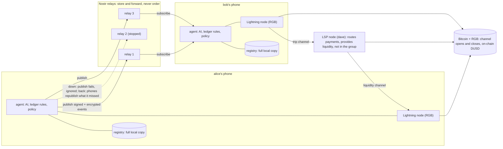

# v2 architecture

This is ongoing work on the v2 branch; the version presented at the final is on main.

This page describes the pieces of kit+ty v2 and how they talk to each other: the phone, the Nostr
relays, the LSP and the blockchain; then the keys, the encryption and the `Transport` interface
that hides the relays from the rest of the code. For the v1 architecture see
[../architecture.md](../architecture.md). Code links point to the
[`v2` branch](https://github.com/marco-pedron/kit-ty/tree/v2).

## Components



The dashed lines show what happens when a relay stops. A phone publishes every event to every
relay; `publish` succeeds as soon as one relay answers OK, so a relay that is down does not stop
anyone. The other phones keep reading from the relays that are up, and since every phone keeps a
full copy of the registry, nothing is lost. When the relay comes back, each phone compares what
the relay returns with its own copy and republishes the events the relay is missing. The events
are signed by their authors, so republishing them cannot alter them. `e2e:demo:v2` stops relay 2
in the middle of the demo and checks that, once it is back, all three relays hold the same events.

### The phone

Each traveler's phone holds three things:

- **the agent**: the on-device AI (QVAC: OCR and an LLM) that reads receipts and proposes splits,
  the ledger rules, and the member's policy (automatic-payment limit per line and daily cap). It
  is a `RegistryAgent`
  ([`flows/registry-agent.ts`](https://github.com/marco-pedron/kit-ty/tree/v2/apps/agent/src/flows/registry-agent.ts));
- **the registry**: a full copy of the trip's events, as received and still encrypted, saved to
  disk (`FileStore`, `infra/data/registry/<member>.jsonl` in the demo). After a restart the phone
  rebuilds the trip from there, even offline;
- **the Lightning node**: the member's own RGB Lightning node, with their trip channel. Only the
  member can spend from it.

**In the demo** the phones are simulated on one laptop: the agents of `alice`, `bob` and
`charlie` run in one Node process (to load the AI once), each with only its own wallet and its
own keys, and each node is a `rgb-lightning-node` in Docker, driven over REST. The node on the
phone is step 8 of the plan (the WDK Lightning module), see the
[roadmap](limitations-and-roadmap.md).

### The Nostr relays

Three [strfry](https://github.com/hoytech/strfry) relays (`dockurr/strfry:1.1.3`) in Docker, on
`127.0.0.1:7001-7003`, regtest only. The trip lists them in `TRIP_CREATED.relays`. They store and
forward events of kind 7345; they cannot read them (the content is encrypted), cannot forge them
(they are signed) and do not order them (the order comes from the events themselves). The worst a
relay can do is withhold events, and the checkpoints make that visible (see
[how it works](how-it-works.md#checkpoints-same-on-33)).

What the relays still see, declared in ADR-001 §12: the per-trip keys of the authors, the trip
tag, the times, the number and size of the events, and who is connected when.

### The LSP

`dave`'s node plays the part of the LSP (in production, the Utexo LSP). It is not a member: it is
not invited, signs no event and does not read the registry. It does two things:

- **routes payments**: the debtor's trip channel → the LSP → the creditor's liquidity channel;
- **provides liquidity**: it opens a liquidity channel of L = 30.00 `DUSD` to each member, so
  they can receive. Since it cannot see the expenses, it watches only its own channels: when a
  member can receive less than 10.00, it reopens up to L
  ([`flows/lsp-agent.ts`](https://github.com/marco-pedron/kit-ty/tree/v2/apps/agent/src/flows/lsp-agent.ts)).

The LSP cannot take anyone's funds: the channels are standard Lightning channels and each member
signs their own payments. A declared risk remains on the punishment path, see
[limitations](limitations-and-roadmap.md).

### The blockchain

Bitcoin regtest with RGB (electrs, Esplora, `rgb-proxy-server`): it sees the channel opens and
the cooperative closes when a member leaves, after which the member's `DUSD` come back on-chain.
Payments between members happen inside the channels, with no block mined.

## Keys

| Key                        | Derived from                                                                                | Used for                                                                                                         |
| -------------------------- | ------------------------------------------------------------------------------------------- | ---------------------------------------------------------------------------------------------------------------- |
| Node key                   | The member's BIP-39 seed (the node's own derivation)                                        | The Lightning node: channels, invoices, payments                                                                 |
| Registry key, one per trip | The same seed, NIP-06 path `m/44'/1237'/<i>'/0/0`, a new index `i` for each trip            | Signing the member's events in that trip (Schnorr, BIP-340). Works offline. Two trips have unrelated keys        |
| Trip secret                | 32 random bytes chosen by whoever creates the trip, passed with the invitation (QR or link) | Deriving the trip tag `T` (so a relay can filter without knowing the trip) and the encryption key of the content |

**Binding the registry key to the node.** When a member joins, `MEMBER_JOINED` carries a
`bindInvoice`: an invoice made by the member's node with the description
`kitty-bind:v2:<tripTag>:<pubkey>`. Its payee is the node, its description names the registry
key and the trip, so it cannot be reused for another key or another trip. Every phone checks it
when the member joins, and from then on every invoice of that member must pay that node.

**Recovery from the seed.** A member who loses the phone derives the registry keys `i = 0, 1, 2…`
from the seed and asks the relays for the events of each key, stopping after 5 empty indexes in a
row. For each trip found, the trip secret comes back from the `TRIP_SECRET_SHARED` event the
member wrote to themselves when joining. `e2e:lose-phone:v2` tests exactly this.

## Encryption

Every event's content is the canonical JSON (RFC 8785) of `{ v: 2, tripId, type, body }`,
encrypted with **NIP-44 v2**. The key is `HKDF-SHA256(tripSecret, "kitty:content:v1")`: every
member knows it, nobody else does. The only exception is `TRIP_SECRET_SHARED`, which carries the
trip secret encrypted to each recipient's key with standard NIP-44 ECDH, because the recipient
does not have the trip key yet.

Two rules keep the format honest: the decrypted content must be byte for byte what the encoder
would write (so a hidden extra field is rejected), and plaintexts are limited to 1–65,535 bytes,
the range every NIP-44 implementation reads.

Declared limit: a member who leaves or is excluded keeps the trip secret and can read later
events. Rotating the secret is on the roadmap.

## The envelope

Each registry event is a standard Nostr event (NIP-01):

| Field        | Value                                                                                                                                           |
| ------------ | ----------------------------------------------------------------------------------------------------------------------------------------------- |
| `kind`       | 7345 (regular, stored by the relays); 27345 is reserved for ephemeral presence messages (step 7)                                                |
| `pubkey`     | the member's registry key for this trip                                                                                                         |
| `tags`       | `["T", tripTag]`, plus one `["e", id]` for each **parent**: the latest events the author knew, always including the author's own previous event |
| `content`    | the NIP-44 ciphertext                                                                                                                           |
| `id`, `sig`  | sha256 of the NIP-01 serialisation, Schnorr signature of the `id`                                                                               |
| `created_at` | informational only; it never decides the order                                                                                                  |

The order: a phone applies an event only when all its parents are applied, then sorts the graph
topologically, breaking ties by the smaller `id`. The same set of events gives the same sequence
on every phone, whatever the arrival order. The full format is in
[ADR-001](https://github.com/marco-pedron/kit-ty/tree/v2/docs/ADR-001-formato-eventi.md) (in
Italian); the code is in
[`packages/shared/src/nostr.ts`](https://github.com/marco-pedron/kit-ty/tree/v2/packages/shared/src/nostr.ts),
[`content.ts`](https://github.com/marco-pedron/kit-ty/tree/v2/packages/shared/src/content.ts) and
[`packages/ledger/src/order.ts`](https://github.com/marco-pedron/kit-ty/tree/v2/packages/ledger/src/order.ts).

## The `Transport` interface

The registry does not know how events travel. It talks to an interface, `RegistryTransport` in
[`flows/registry-transport.ts`](https://github.com/marco-pedron/kit-ty/tree/v2/apps/agent/src/flows/registry-transport.ts):

```ts
interface RegistryTransport {
  publish(e: NostrEvent): Promise<void>; // to every relay; never throws for a relay that is down
  query(f: RegistryFilter): Promise<readonly NostrEvent[]>; // stored events, no duplicates
  subscribe(f: RegistryFilter, onEvent: (e: NostrEvent) => void): () => void; // stored, then live
  fetchMissing(ids: readonly string[]): Promise<readonly NostrEvent[]>; // parents not yet here
}
```

Two implementations exist:

- `NostrTransport`
  ([`relay/nostr-transport.ts`](https://github.com/marco-pedron/kit-ty/tree/v2/apps/agent/src/relay/nostr-transport.ts)),
  NIP-01 over Node 22's `WebSocket`, with no new dependency: one per phone, publishing to and
  reading from every relay, reconnecting, and republishing to a relay that comes back;
- `MemoryTransport`, an in-process relay for the tests.

Whatever the transport delivers, the registry verifies every event itself (signature, format,
rules on its ancestors). A transport can only deliver or withhold. This is where a peer-to-peer
transport such as Holepunch would plug in, without touching the registry or the ledger
([roadmap](limitations-and-roadmap.md)).

## Configuration

| Variable                   | Default                                                       | Meaning                                                                        |
| -------------------------- | ------------------------------------------------------------- | ------------------------------------------------------------------------------ |
| `KITTY_REGISTRY`           | `v1`                                                          | `v2` runs the travelers on the registry v2 and `dave` as the LSP               |
| `KITTY_NOSTR_RELAYS`       | `ws://127.0.0.1:7001,ws://127.0.0.1:7002,ws://127.0.0.1:7003` | The relays of the trip                                                         |
| `KITTY_REGISTRY_DIR`       | `infra/data/registry`                                         | Where each phone keeps its local copy                                          |
| `KITTY_CHECKPOINT_SECONDS` | 10 in the demo                                                | Minimum interval between two checkpoints of a member (5 minutes in production) |
