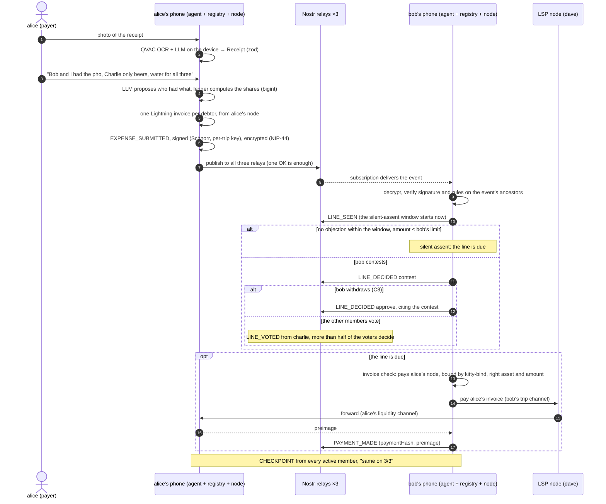

# How v2 works

This is ongoing work on the v2 branch; the version presented at the final is on main.

This page follows one expense from the photo of the receipt to the payment, then explains the
rules a group lives by when nobody is in charge: blocks, leaving, contests and votes, exclusion.
It is written for readers who do not know the project; the components it mentions are described
in the [architecture](architecture.md). For v1 see [../how-it-works.md](../how-it-works.md).

The demo group is `alice`, `bob` and `charlie`. `dave`'s node is the LSP: it routes the payments
and is not part of the group.

## The life of an expense

Step by step:

1. **Read the receipt.** The payer photographs the receipt. QVAC runs OCR and a small language
   model on the device; the result is validated against a schema, and code checks that items, tax
   and tip add up to the total. The payer can fix any row. The photo never leaves the phone: only
   its sha256 goes into the event.
2. **Split.** The payer writes who had what in plain words. The model only proposes which member
   had which item, constrained to existing members and item numbers; the ledger computes every
   share in integer units of the asset, with the exchange rate saved on the payer's phone. The
   rate is part of the expense, so every debtor sees the rate they are charged.
3. **Sign and encrypt.** The payer's agent creates one Lightning invoice per debtor on the payer's
   own node and writes an `EXPENSE_SUBMITTED` event: the proposal (receipt, rate, shares) and,
   next to it, the invoices. It cites the latest events the payer knew, signs the event with the
   payer's key for this trip (Schnorr) and encrypts the content (NIP-44).
4. **Publish.** The event goes to all three relays. One OK is enough; a relay that is down gets
   the event later.
5. **Validate on the other phones.** Each phone decrypts the event and checks it: signature,
   exact encoding, and the rules evaluated on the event's ancestors (the payer and the debtors are
   members, nobody involved blocked the other, the shares recompute exactly, each invoice pays the
   payer's node for the right asset and amount). An event whose parents are missing waits, and the
   phone asks the relays for the missing parents.
6. **Seen, then silent assent.** Each debtor's agent publishes `LINE_SEEN`. The window starts here,
   on the debtor's own clock, so an expense posted at night does not expire while the debtor
   sleeps. If the debtor does nothing and the share is under their automatic-payment limit, the
   line becomes due. Above the limit, the debtor must approve explicitly.
7. **Or a contest.** The debtor can contest with a reason. A contested line is never paid
   automatically. It ends in one of three ways: the debtor withdraws (C3), the other members vote,
   or the payer voids the expense. See [contests and votes](#contests-and-votes).
8. **Check the invoice.** Before paying, automatically or by hand, the debtor's app checks that
   the invoice pays the node the creditor bound to their key when joining (`kitty-bind`), and that
   asset and amount match the share. Otherwise the line is not paid.
9. **Pay through the LSP.** The payment goes from the debtor's trip channel, through the LSP, to
   the creditor's liquidity channel, in a few seconds and with no block mined. The debtor's agent
   pays one invoice at a time and respects its daily cap.
10. **Proof.** The debtor publishes `PAYMENT_MADE` with the payment hash and the preimage. Anyone
    in the group can check that the preimage hashes to the invoice's payment hash.
11. **Checkpoints.** Each active member periodically publishes a `CHECKPOINT`: the events it
    knows and a hash of the state they produce. Each phone compares them; see
    [checkpoints](#checkpoints-same-on-33).

### Line states

| State               | When                                                                                                                                   |
| ------------------- | -------------------------------------------------------------------------------------------------------------------------------------- |
| `submitted`         | The expense is in the registry; the debtor has not seen it yet                                                                         |
| `awaiting_decision` | The debtor has seen it; the silent-assent window is running                                                                            |
| `awaiting_explicit` | The window is over but silent assent does not apply (above the limit, or the line arrived after the debtor left or after an exclusion) |
| `due`               | Approved, assented, signed at the table, or decided "due" by a vote                                                                    |
| `manual_only`       | Due, but blocked or excluded members are involved: only a manual payment                                                               |
| `contested`         | The debtor contested and nothing has decided it yet                                                                                    |
| `paid`              | A valid `PAYMENT_MADE`                                                                                                                 |
| `voided`            | The payer voided the expense, or a vote voided the line                                                                                |

There is no `overdue` and no `guaranteed` state: without a coordinator, nobody covers a default.

### The agent's limits

Each member sets two limits: the automatic-payment limit per line and the daily cap of automatic
payments. When two policy changes of the same member are concurrent, the most prudent value of
each field wins (C12). Shares signed by the debtor at the table count as explicit consent: they
are paid even above the per-line limit and do not count towards the daily cap (D4). The agent
explains every decision to the member with the amount and the reason, for example why a line
was not paid ("Not paid: … would exceed your daily cap … Approve it yourself.").

## Order and conflicts, in plain words

Without a server that orders events, two members can write at the same time without seeing each
other. v2 deals with this in two ways:

- **one order for everyone**: each event cites the events its author knew, and every phone sorts
  the same graph the same way. The order never depends on which relay delivered first or on
  anyone's clock;
- **rules that look at what was known, not at who came first**: an event's author knew X only if
  X is among the event's ancestors. Rules that move money use only this, because a tie-break on
  the event id could be gamed by trying many variants of an event.

The fifteen conflict rules (C1–C15) are pure functions with a test each. A few examples: a
concurrent "approve" and "contest" on the same line, the contest wins (C1); a payment and a
voiding of the expense, the payment wins for the line it paid (C2); two expenses with the same
receipt fingerprint, both stay valid and are flagged as a possible duplicate (C10).

## The rules of the group

### Joining

A member invites someone (`MEMBER_INVITED`, with an expiry); the invitee joins with that
invitation (`MEMBER_JOINED`), their display name, their node and the `kitty-bind:v2` invoice that
binds their per-trip key to their node. One invitation, one entry (C13). The invitation package
(the trip secret and the invitation reference) travels in a QR code or a link. Every member then
writes the trip secret encrypted to their own key (`TRIP_SECRET_SHARED`), which is what makes
recovery from the seed possible.

### Blocks

A block is between two people, and its purpose is to have no debts or credits with someone.

- If bob blocks alice, from the moment the block is known no expense can have one of them as the
  payer and the other as a debtor, in either direction. Such an expense is invalid as a whole; the
  app does not let you create it and says why.
- An expense paid by a third member, with alice and bob both debtors, stays valid: no money moves
  between them.
- Expenses recorded before the block was known stay valid, and the debts between the two are
  settled normally.
- Only the member who blocked can unblock (`MEMBER_UNBLOCKED`). If a block and an unblock by the
  same author are concurrent, the block wins (C7).
- Before blocking, the app warns that the block also counts towards exclusion, and how many
  members already block that person.

### Exclusion

A member is excluded when **more than half of the other active members** block them. The count
is made on what the block that reaches the majority knew, so concurrent blocks and unblocks do
not change the outcome.

- Exclusion is **final**: a later unblock does not undo it. Coming back takes a new invitation.
- An expense is valid only if the exclusion is not among its ancestors.
- The excluded member's debts stay and are paid by hand. On lines that arrived concurrently with
  the exclusion, silent assent does not apply.
- Only active members count, among those who block and among the others.

There is no guarantee in v2: exclusion keeps a member out, but it does not pay back the creditor.

### Contests and votes

A debtor contests a line with a reason. The line is blocked and is never paid automatically. Three
things can end it:

- **the debtor withdraws (C3)**: an approval that has the debtor's own contest among its ancestors
  withdraws it. If the approval and the contest are concurrent, the contest wins (C1);
- **the other members vote** (`LINE_VOTED`, "due" or "voided"). The voters are the active members
  other than the creditor and the debtor of the line. More than half of the voters decide,
  counted on what the deciding vote knew, one vote per voter. The outcome is final. A line
  decided "due" by vote is not paid automatically until the debtor approves it or pays by hand;
  an approval by the debtor concurrent with a "voided" outcome wins;
- **the payer voids the expense** (`EXPENSE_VOIDED`), except for the lines already paid (C2).

The majority rule is provisional and lives in one place in the code, because the final model for
disputes without an arbiter is still open. In a group of three there is a single voter.

### Leaving

A member leaves with `MEMBER_LEFT`, valid only if they have no known debts, contested lines
included. Then their wallet closes their two channels with the LSP, cooperatively, and their
`DUSD` come back on-chain; if a close fails, the agent retries.

- A member can leave with credits still to collect. Before confirming, the app lists them (from
  whom and how much) and warns that, with the channels closed, they will be collected outside the
  app.
- An expense concurrent with a member's exit stays valid: the debt remains, flagged "arrived
  after leaving", and silent assent does not apply. The member who left can still approve or
  contest it (C9).

### Closing the trip

Nobody closes the trip. It is closed when every member has left, and every phone computes that on
its own.

## Checkpoints: "same on 3/3"

Each active member publishes a `CHECKPOINT` when its state has changed and has been quiet for a
few seconds (at most one every 10 s in the demo, every 5 minutes in production). A checkpoint
declares the events it cites, how many events they cover and a hash of their sequence
(`stateHash`). Each phone checks the latest checkpoint of every active member:

- **verified** if the phone has all the cited events and recomputes the same count and hash. If
  not, a relay is hiding something, or there is a bug;
- **same state** if, leaving the checkpoints themselves aside, it covers exactly the events the
  phone has.

"Same on N/N" is the number of checkpoints that are verified and agree. Every phone's agent
reports it in its state (`ledger.checkpoints`), and `e2e:demo:v2` checks it on all three phones;
the UI does not show it yet. A relay that
shows different histories to different members, or withholds events, is detected this way. It
cannot be prevented, but it cannot go unnoticed.

## Where the rules live

All rules are pure functions in `packages/ledger`, run by every phone on the same events:
[`order.ts`](https://github.com/marco-pedron/kit-ty/tree/v2/packages/ledger/src/order.ts) (the
order),
[`conflicts.ts`](https://github.com/marco-pedron/kit-ty/tree/v2/packages/ledger/src/conflicts.ts)
(C1–C15) and
[`registry/`](https://github.com/marco-pedron/kit-ty/tree/v2/packages/ledger/src/registry)
(`fold.ts` for blocks, exclusion and votes, `validate.ts`, `derive.ts` for line states,
`autopay.ts` for the agent's decision and the invoice check). The decisions behind them are in
[ADR-001](https://github.com/marco-pedron/kit-ty/tree/v2/docs/ADR-001-formato-eventi.md) and
[`docs/proposte/regole-conflitto.md`](https://github.com/marco-pedron/kit-ty/tree/v2/docs/proposte/regole-conflitto.md)
(in Italian).
